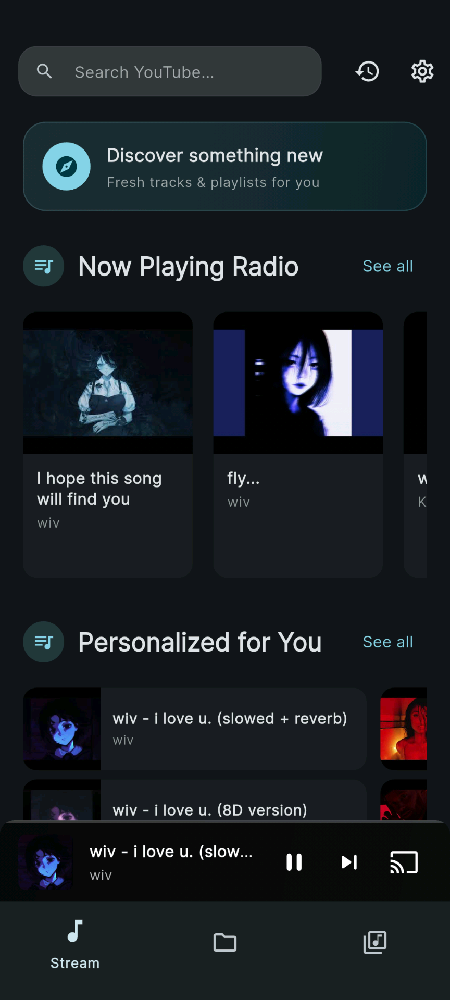
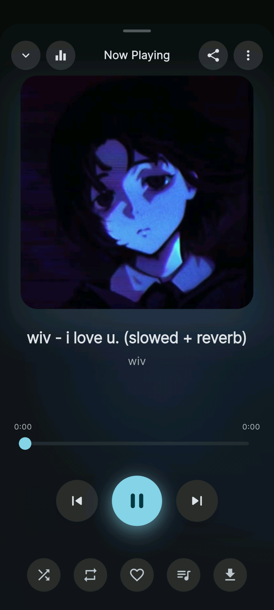
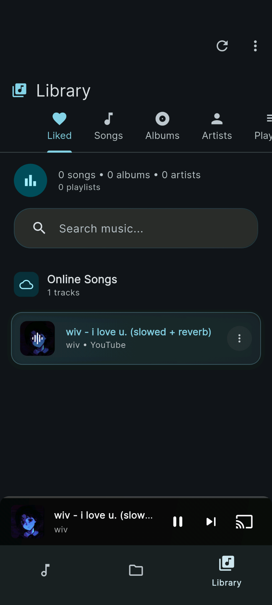
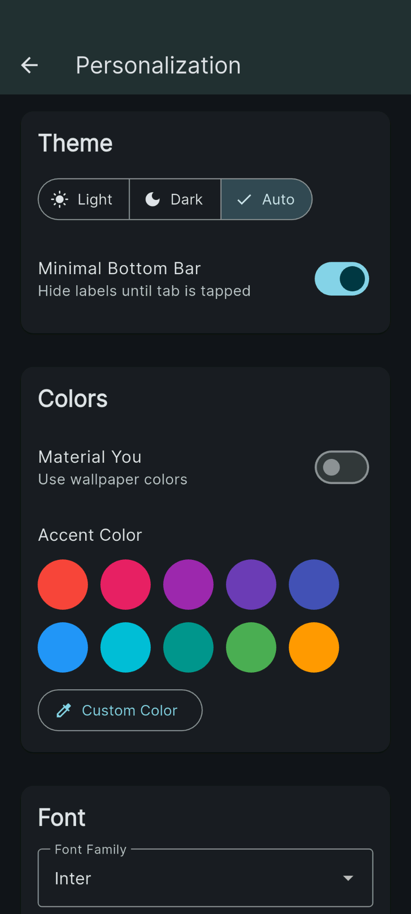
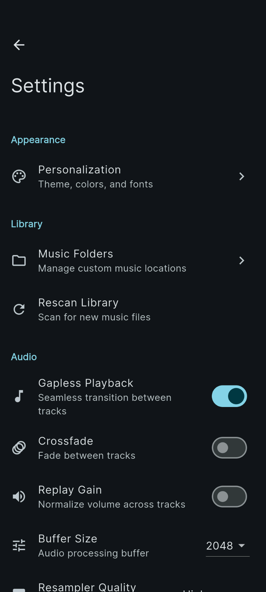
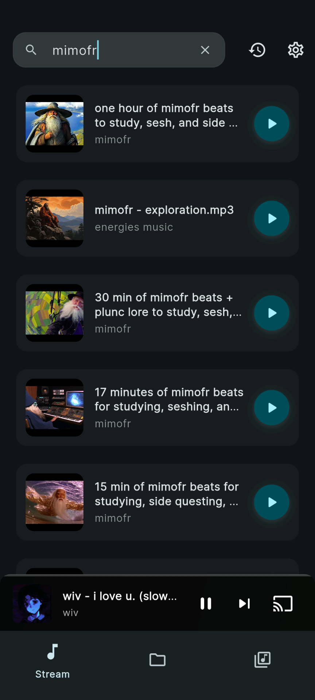
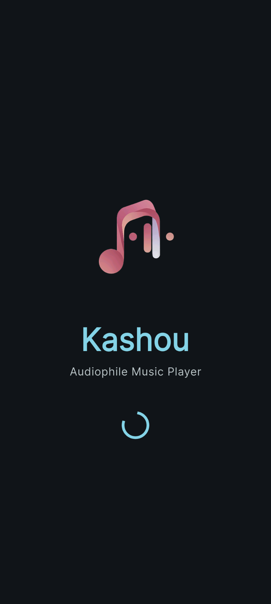

# Kashou

Kashou is an open source music player built with Flutter. I wanted a Poweramp-style local player that could also stream from YouTube, so I built one.

## Features

- Local library playback with queues
- YouTube streaming
- Gapless playback and crossfade
- Equalizer, bass boost and other sound effects
- Background playback and media controls
- Chromecast support

## Platforms

| Platform | Build | Notes |
|---|---|---|
| Android | APK per ABI | Equalizer and Chromecast |
| Windows | zip | Tray icon and system media controls |
| Linux | tar.gz and AppImage | Tray icon and MPRIS |
| iOS | unsigned IPA | Sideload with AltStore or similar; drop songs into Kashou in the Files app |
| macOS | DMG | Ad-hoc signed, right click > Open on first launch |

Every push to `feature-equalizer` builds all five in GitHub Actions.

## Gallery

<p align="center">
	
	
	
	
	
	
	
</p>

## Build

```bash
git submodule update --init --recursive
flutter pub get
flutter run
```

iOS and macOS builds need Xcode 26 and CocoaPods.

## License

See the license file for details.
